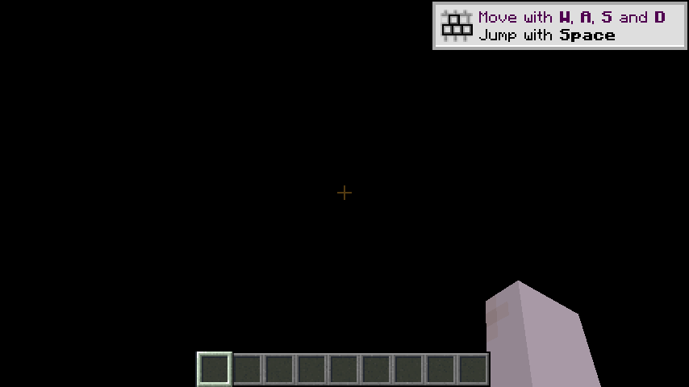

# ballance-mc-passthrough

[中文](README.md) | **English**

Alpha-composite **Minecraft's frame into Ballance**, and let the two **unmodified** games drive each other:
Ballance's camera and ball position feed Minecraft as its camera, and Ballance's mouse and keyboard feed Minecraft as input.

The target gameplay: on Ballance's tracks, **place blocks, plant TNT, and blow the ball up with a creeper** — the ball
should hit the walls you build and stand on the bridges you build.

The technical blueprint is `minecraft-gta5-passthrough` (GTA5 ↔ Minecraft) from
[rehan-remade/universal-modder](https://github.com/rehan-remade/universal-modder). The blueprint's **content layer**
(blocks / mobs / TNT / interaction on the MC side) can be carried over wholesale; what has to be replaced is the
"host adapter layer": GTA's native calls → Virtools CK2 on the Ballance side.

> This document was rewritten on 2026-11-07 and realigned once more on 2026-11-10. The 11-07 pass fixed two defects:
> the milestone table was stuck at "in progress" (M1 / M1c / M2b had long been accepted), and the text never once
> explained **how to get the two games running** (the 11-07 "no MC HUD at all, view stuck at the origin" was caused
> by starting only the Ballance half). The 11-10 pass aligns it with the four hand-found bugs of 11-08: crash on
> level change, blocks that will not be placed, crosshair not tracking the ball, and 5 fps when minimized.

## 0. Getting started (three minutes)

**Two processes, and the order cannot be reversed.** MC only has something for Ballance to composite when it is
running; with MC down there is not a single MC pixel on screen.

### 0.1 Two steps

```bat
:: 1) start MC first — the launcher inside J:\bmc-project\runtime\mc (bundled JDK),
::    wait for it to enter the void world by itself, 20–40 s
:: 2) then start Ballance (a double-click is enough)
J:\bmc-project\runtime\run-ballance-mc.bat
```

`run-ballance-mc.bat` does exactly two things: set `BALLANCE_MC_PASSTHROUGH=1`, then start `Bin\Player.exe`.
`run-ballance-plain.bat` in the same directory sets it to `0`, for an on/off A/B of passthrough.

### 0.2 Three easy traps

1. **Double-clicking `Bin\Player.exe` directly = vanilla Ballance.** A double-click cannot carry environment
   variables, so `BALLANCE_MC_PASSTHROUGH` is unset and passthrough is off entirely. This is deliberate: a broken
   mailbox must not stop the game from starting.
2. **Reversing the order means waiting forever.** Start Ballance before MC and the log says
   `waiting for ...ballance_mc_frame.dat (producer not running yet, error 2)`; waiting a full round does not fix it.
3. **The MC window may be minimized, but must not be closed.** What gets composited into Ballance is the image MC
   renders every frame; close it and the source is gone. Minimizing used to be fatal (vanilla throttles a minimized
   window to 10 fps, measured at 5); on 11-08 it was opened up to 60, see 2.3.

### 0.3 How to confirm it is really working

| Where to look | What you should see |
|---|---|
| `runtime\Bin\mc-passthrough.log` (one line every 2 s) | `mapped … (4923136 bytes)` → `baseline frame N (published before this run, not drawn)` → `frames=… draws=… (N fps consumed)` |
| `runtime\mc\logs\latest.log` | `published N frames in 5s (~N fps), skipped N, failures 0, transparent 87.6%`, `applied pose … at=(x, y) gap=66.0px aim=(yaw, pitch)` |
| The Ballance window | a crosshair above the ball (that pixel `gap`), the nine-slot hotbar along the bottom, an arm in the lower right — **all three are drawn by MC itself**, not patched in by Ballance |

`waiting for … error 2` repeating = the producer is not running; passthrough is not broken.

## 1. What works today

| Capability | Status | Evidence |
|---|---|---|
| MC's frame composited into Ballance, transparent sky lets the track show through | ✅ M2b | [docs/mc-void-world.md](docs/mc-void-world.md) |
| Crosshair / hotbar / hearts / arm arrive with that frame | ✅ | drawn by MC; this is exactly what was decoded from the mailbox on 11-07 |
| Camera: MC's world follows Ballance's viewpoint | ✅ M1 | [docs/m1-camera.md](docs/m1-camera.md) |
| Third person draws only the ball, first person draws only the arm | ✅ | [docs/steve-in-ballance.md](docs/steve-in-ballance.md) |
| Reverse input: E opens the creative inventory, the wheel changes slot, clicking picks an item | ✅ M1b | [docs/m1b-input.md](docs/m1b-input.md) |
| Place / break blocks; when the ray misses, spawn 4.5 blocks in front of the crosshair | ✅ M1c | [docs/m1c-place.md](docs/m1c-place.md) |
| Right-click really places a block on the track | ✅ 11-08 | the server-side eye is synced to the ball every tick, see 2.3 |
| Crosshair pinned at a **fixed pixel** offset above the ball; the gap no longer changes with camera distance | ✅ 11-08 | [docs/m1b-input.md](docs/m1b-input.md), section 5 |
| A fresh world per level; old worlds archived by timestamp instead of deleted | ✅ 11-07 / 11-08 | [docs/level-worlds.md](docs/level-worlds.md) |
| Knows which level it is: Ballance writes the level filename into the camera channel, MC picks the template by number | ✅ M1c | [docs/voxel-import.md](docs/voxel-import.md), section 5 |
| Level terrain import: track / walls / pillars become **invisible** barriers, so redstone, rails and torches have somewhere to go | ✅ 11-08 | [docs/voxel-import.md](docs/voxel-import.md) |
| 13 levels pre-baked into save templates, copied on level entry; a new instance every time | ✅ 11-08 | [docs/voxel-import.md](docs/voxel-import.md) |
| Level changes no longer crash (the stale block-placing progress is rebuilt for the new level) | ✅ 11-08 | see 2.3 |
| Minimizing the MC window no longer drags the whole chain down to 5 fps | ✅ 11-08 | see 2.3 |
| The MC-side player's collision box is **one block** (1×1×1, revertible) | ✅ 11-08 | `BALLANCE_MC_PLAYER_BOX=0` restores 0.6×1.8 |
| F1 settings panel, nine rows that take effect in place | ✅ | [docs/settings-panel.md](docs/settings-panel.md) |
| Free view: press F to orbit the camera around the ball, the ball's travel direction is unchanged | ✅ 11-08 | [docs/free-view.md](docs/free-view.md) |

Scale: **1 block = 5.48 Ballance units** (the default; row **8** of the F1 panel, `Block`, can change it). 4.0 is the
"one ball diameter" figure in the calibration table, but it does not match the 5.48 of the ball transformers
`P_Trafo_*`; the latter is used, for the reasoning see
[docs/scale-calibration.md](docs/scale-calibration.md). All 472,534 triangles of the 13 levels can be exported
offline and baked into 115,461 block cells (54,279 of them walkable surfaces).

## 2. Real-machine tests

### 2.1 Cold start, 2026-11-07

Run on the Windows test machine (Win11 + real GPU), starting at 12:31:14:

| Time | Event |
|---|---|
| 12:31:19 | start MC |
| 12:31:34 | the mailbox `.dat` appears (**15 s**, faster than the estimated 20–40 s) |
| 12:31:59 | start Ballance |
| 12:33:04 | last-frame diagnostic captured |

| Metric | Value |
|---|---|
| MC publish | **15 fps**, 75 frames per 5 s, skipped 75, failures 0 |
| Transparent share | **87.6%** (alpha=0) — the sky really was removed |
| Ballance consume | 14–24 fps, `frames=1240 draws=3832 misses=1 rejected=0` |
| Stale-frame guard | `baseline frame 628 (published before this run, not drawn)` |



The image above is **not a screenshot**: it was decoded straight out of the slot MC published, then alpha-composited
onto a black background. That route was necessary because desktop capture failed that day, see 2.2.

### 2.2 Hit and fixed: stale frames

On Windows the mailbox is just a `.dat` file on disk, and **it does not disappear when the process exits**. So on a
new run the consumer's first mapping already reads the frame left behind by the previous run, and keeps smearing it
on screen — half of the 11-07 report "the view jumped to the coordinate origin" was exactly this: the screen showed
an old MC frame.

The fix: on the first mapping, take the current `FrameId` as the baseline (`baseline frame N`) and draw only frames
published after it. The change is in `tools/ballanced-patches/RenderEngine.patch`.

**A locked screen cannot be captured**: the automated evidence path used `Graphics.CopyFromScreen`, and once the
workstation locks, a session-1 process can no longer obtain the image (either a fully black screen or
`Win32Exception: invalid handle`). So every conclusion in 2.1 took the independent **mailbox decode** route:

```python
# 4096-byte header, 3 slots, layout in tools/passthrough/mpframe.h
magic, ver, w, h, stride = struct.unpack_from("<5I", data, 0)
frameid, slot = struct.unpack_from("<2I", data, 32)
offset = struct.unpack_from("<3Q", data, 56)[slot]
```

### 2.3 2026-11-08: four hand-found bugs

Four things reported over a single session. None of their root causes were where the previous version assumed.

**① Crash at 15:02:45 — `Index 7206 out of bounds for length 7206`**

After `adopt()` switched levels, `LevelVoxels.placeSome` took the modulo against the **new** level's cell count
(7640) and indexed into the **old** level's `done[]` (7206). Fix: `adopt()` clears `done/cursor/counts` on a level
change, `placeSome` re-validates the length on entry and rebuilds when it does not match; and "return once
everything is placed", so it no longer scans 7000 cells every tick.

**② A block "flashes once and is then gone", and one spot never accepts a block**

The server-side player's eye lagged the client by **8.0 blocks** and stayed that way for tens of seconds. The client
snaps itself onto the ball every tick, but the server-side player is moved only by movement packets — and once the
server is waiting for a teleport to be acknowledged, subsequent movement packets are silently dropped. So when a
block was targeted, vanilla placement ran, the server recomputed the distance from scratch, it exceeded reach, the
placement was rejected and the client rolled it back: the block flashed for one frame.

Fix: `CameraSync` writes the same position and orientation into the `IntegratedServer`'s `ServerPlayer` every tick,
**bypassing the network** — the local single-player server lives in the same process, so reach and line of sight are
now computed from the crosshair's own position. Two accompanying changes: the pose is applied at the **start** of the
tick (it used to be TAIL, which meant this tick's ray cast and next frame's camera used two different poses — that was
the source of the flickering selection box); and `client.hitResult` is refreshed with the freshly computed pick
before the right-click is dispatched.

**11-13 follow-up: ② was only half right.** In a 2m12s log from `bmc-tpl-10`, 14 right presses gave
`clientSays` / `serverSays` **14/14 identical**, with a client/server eye difference of 0.00..0.11 blocks --
the two sides had been in sync all along. "One spot never accepts a block" had another cause: in 3 of those
14 presses the cell the block would have gone into already held the level's own invisible `barrier`, so
vanilla had no cell to place into and told nobody. A right press now has four outcomes -- nothing under the
ray, a replaceable target cell, a target cell holding a barrier, and everything else; the barrier case
replaces that cell with the held block (full collision cubes only: the barrier is what the ball rolls on),
and every refusal prints `blocked_by=`. Each placement is read back within four ticks and logged as
`placement ok` or `placement refused`, so whether the click worked no longer has to be argued from
position readings. The `aim target changed` predicate changed with it: it counted changes per second, which
is what fast rolling and respawn teleports look like (all six reports in that run were 24-block teleports);
it now counts returns to a cell the aim has just left (A->B->A). Details in
[docs/m1c-place.md](docs/m1c-place.md).

**③ The crosshair does not follow the ball**

"Not following" is really "the gap keeps changing": the pitch offset is 20°, and how many pixels 20° amounts to
depends on how far the camera is from the ball (measured 6.66..18.71 blocks). Once the ball is fast, the camera
cannot keep up, the ball drifts as much as 26° off the screen centre, and the whole difference is added to the gap —
across 73 pose samples from one session, the crosshair-to-ball distance ranged **39.2 .. 108.1 px**.

The fix is not "turn by a different angle" but a different way of measuring: draw the crosshair at **the ball's own
projection plus a fixed pixel offset** (`CameraSync.gapGui`; `AimLift` is still the only control, still 0..30
degrees, scale 3.3 px/degree, 20° = 66 px), then **analytically solve back** for the player rotation that puts the aim
point on that pixel — the aim point must lie both on the camera ray through that pixel and exactly 4.5 blocks from
the eye, i.e. "ray ∩ sphere", taking the **far root** (the near root would wedge the block between the ball and the
camera). Recomputing the 73 samples offline: the gap is **66.00 px** in every one, plus or minus 0.0.

**④ Minimizing drops to 5 fps**

MC logged a line every 5 s: `~25 fps` with the window in the background, and `~5 fps` the moment it was minimized
(`Cannot acquire minimized window`), with the Ballance side dropping to `4-5 fps consumed` at the same time. It hit
`FramerateLimitTracker`'s `WINDOW_ICONIFIED` (vanilla 10, measured 5). `FramerateLimitTrackerMixin` opens up only
that one branch: default 60, tunable via `BALLANCE_MC_ICONIFIED_FPS`; the AFK throttle and the player's own
framerate setting are untouched.

**⑤ An extra one: the baked world would not unpack**

The save path contained a `.` component (`…\runtime\.\mc\saves`); `Path.normalize()` stripped it from the entry
target but left it in `dir`, so all 30 entries were judged as "escaping the directory", not a single file was
unpacked, there was no `level.dat`, and the client silently fell back to a pure void world. Fix: normalize both
sides with `toAbsolutePath().normalize()` before the containment check.

## 3. Not done yet

| Stage | Content | What is missing |
|---|---|---|
| M2c | Depth compositing (reprojection) | Pillars still cannot occlude MC's walls — this is a whole-frame alpha blend, with no per-pixel depth |
| M3b | Ground raycast | Steve cannot stand on the track yet; his feet clip through |
| M3c | Blocks → colliders | **The ball still cannot hit the walls you build** — this is the backbone of the target gameplay (PoC-2 already proved the mechanism works) |

Known boundaries (not bugs, but the current contract):

- The price of a constant crosshair gap: on frames where the camera is unusually far (just entered a level, 18.7
  blocks) the player's pitch is lifted a little more than before, so blocks land a cell or more above the ball rather
  than near its centre — lower `AimLift` and they come back onto the ball.
- Opening the creative inventory freezes the ball (`timeScale` goes to zero). That is by design, not a hang.
- The baked templates hard-code the cell size (5.48 u by default): set row 8 of the panel to anything else and the mod
  refuses to place and logs a warning; changing the size means re-running `voxelize.py` + `bake-levels.sh`.

## 4. The two channels

| | Frame channel (M0b) | Camera channel (M1) |
|---|---|---|
| Direction | MC → Ballance | Ballance → MC |
| Content | BGRA8 pixels, 3 rotating slots, same width and height as the Ballance window | ~100 bytes of scalars + input fields |
| Writer | Fabric mod | `Source/Player/src/MinecraftCameraSync.cpp` |
| Reader | `CKSdlGpuPassthroughTick` | `McCameraChannel` → `CameraMixin` |
| Linux | `/dev/shm/ballance_mc_frame` | `/dev/shm/ballance_mc_camera` |
| Windows | `%LOCALAPPDATA%\BallanceMcPassthrough\ballance_mc_frame.dat` | `ballance_mc_camera.dat` in the same directory |
| Ordering | `FrameId` publish, acquire/release | **seqlock** (Seq read before and after) |

The mailbox layout is `tools/passthrough/mpframe.h`, with a mirrored implementation on each side, and
`tools/passthrough/inspect-mailbox.py` / `inspect-camera.py` are independent third-party readers —
**only if they can read it is the layout proven to be intact**.

| Environment variable | Read by | Effect |
|---|---|---|
| `BALLANCE_MC_PASSTHROUGH=1` | Ballance | master switch, off by default |
| `BALLANCE_MC_SHM` | both | mailbox name, default `ballance_mc_frame` |
| `BALLANCE_MC_MAILBOX` | Ballance | give an absolute path directly |
| `BALLANCE_MC_FPS` | MC | publish rate limit, default 30 |
| `BALLANCE_MC_ICONIFIED_FPS` | MC | target framerate while minimized, default 60 |
| `BALLANCE_MC_PLAYER_BOX=0` | MC | collision box back to vanilla 0.6×1.8 |
| `BALLANCE_MC_EXPORT=0` | MC | export fully off (which also disables the two above) |

The nine panel rows' ini keys and environment variables are in [docs/settings-panel.md](docs/settings-panel.md).

## 5. Milestones

| Stage | Content | Status |
|---|---|---|
| PoC-0 | Feasibility: depth / raycast / dynamic colliders / Linux build | ✅ [docs/feasibility.md](docs/feasibility.md) |
| PoC-1 | Attach a probe to depth, dump one frame | ✅ [docs/poc1-depth.md](docs/poc1-depth.md) |
| PoC-2 | Add and remove dynamic obstacles, the ball can hit them | ✅ [docs/poc2-obstacles.md](docs/poc2-obstacles.md) |
| M0 | Shared-memory link + full-screen blit | ✅ |
| M1 | Camera + ball position = Steve's position | ✅ 11-05 |
| M1b | Reverse input: E / mouse / wheel drive MC's inventory | ✅ [docs/m1b-input.md](docs/m1b-input.md) |
| M1c | Place and break blocks in the world, level recognition, terrain import | ✅ 11-07 / 11-08 |
| M2a | Void world + sky removal | ✅ [docs/mc-void-world.md](docs/mc-void-world.md) |
| M2b | Alpha blending on the Ballance side | ✅ 11-06 |
| M2c | Depth compositing (reprojection) | ⬜ |
| M3a | Input forwarding (left/middle click in the world, right-click placement) | ✅ 11-08 (only truly reliable after the server-side eye sync) |
| M3b | Ground raycast | ⬜ |
| M3c | Blocks become colliders | ⬜ |

## 6. Directory

```
docs/feasibility.md        PoC-0 evidence and conclusions
docs/poc1-depth.md         PoC-1 depth probe
docs/poc2-obstacles.md     PoC-2 dynamic colliders
docs/m1-camera.md          M1 camera channel, including three traps
docs/m1b-input.md          M1b reverse input + crosshair gap (2026-11-08)
docs/m1c-place.md          M1c placing/breaking blocks, incl. FOV and framing
docs/mc-void-world.md      M2a/M2b void world + alpha compositing, five traps
docs/steve-in-ballance.md  how Steve's body is drawn
docs/free-view.md          free view (F to orbit the ball)
docs/free-camera.md        free camera (for debugging)
docs/level-worlds.md       a new world per level, old worlds archived
docs/voxel-import.md       level terrain → barriers, 13 baked templates (2026-11-08)
docs/settings-panel.md     the nine F1 panel rows and their precedence
docs/level-parse.md        reading level geometry offline
docs/scale-calibration.md  the scale calibration table
docs/windows-build.md      how to build the Windows package (toolchain / traps / layout)
docs/bmlplus-hooks.md      audit of BML+ hook capabilities (the other route)
docs/bmlplus-hud-mod.md    feasibility of the ".bmodp HUD" (not adopted)
docs/*-shots/              acceptance screenshots
mc-mod/                    the MC-side Fabric mod (with 13 level templates under assets/ballance/templates)
tools/passthrough/         frame/camera channel protocol, both halves, acceptance scripts
tools/voxel/               triangles → block cells → baking → template packaging
tools/ballanced-patches/   patches against Ballanced's four submodules (see §7.4)
tools/windows/             the three batch files on the test machine (launcher / layout / rebuild+deploy)
tools/windows-sync.sh      package sources → upload → unpack (supports --build / --jar / --deploy)
tools/nmo_geom.cpp         read .nmo and export world-space OBJ + JSON (libcmo21)
tools/calibrate.py         derive the scale table from exported assets
external/fetch-upstream.sh fetch upstream Ballanced / CKRenderEngine (not distributed with this repo)
```

## 7. Artifacts and deployment

### 7.1 The two artifacts

| Artifact | Where it comes from | Where it goes |
|---|---|---|
| MC-side mod jar | `cd mc-mod && ./gradlew25 build` → `mc-mod/build/libs/ballance_passthrough-1.0.0.jar` | `runtime\mc\mods\` |
| Ballance-side `Player.exe` + plugin DLLs | `tools/windows/rebuild-pt.cmd` (scheduled task `bmc-pt`): configure → build → robocopy | `J:\bmc-project\runtime\{Bin,RenderEngines,…}` |

The jar of the current build (`2ef805b`) is **12,581,522 bytes, md5 `2ffd92b70e2f6faa03550c7cc34784f8`**.
The 2026-11-13 build has only been built on the dev machine and smoke-tested on Linux -- it is **not on the 128
box yet** (that host was unreachable), which still runs the 11-08 `66bfb760...`.

`rebuild-pt.cmd` copies only `.exe`/`.dll` into the runtime directory and **does not touch**
`Player.ini` / `Minecraft.ini` / logs, so rebuilding never loses the settings in your panel. Note, per the upstream
author's own explanation: **the renderer is a plugin, not the main program** — after swapping code, `Player.exe`'s
mtime may not change; the file that actually changes is `RenderEngines\CKSdlGpuRasterizer.dll`. Do not take
"exe unchanged" for "not built".

### 7.2 How the sources get over there

**The Windows machine does not keep sources, only copies.** Everything is packaged and pushed from the dev machine by
`tools/windows-sync.sh`; switching machines, reinstalling and reproducing all take the same route (details and three
traps in [docs/windows-build.md](docs/windows-build.md)).

### 7.3 What `artifacts\SHA256SUMS.txt` covers

`artifacts\` next to the runtime directory is the release snapshot, and `SHA256SUMS.txt` currently has **5 lines**:

```
runtime/mc/mods/ballance_passthrough-1.0.0.jar
artifacts/ballance_passthrough-1.0.0.jar
artifacts/Player.patch
runtime/Bin/Player.exe
runtime/RenderEngines/CKSdlGpuRasterizer.dll
```

**It does not include** `CK2.dll` / `VxMath.dll` / `CK2_3D.dll` / `SDL3.dll`, nor this README — those are upstream
build outputs or documentation, and changing them does not require recomputing these numbers. There is only one way to
verify it: `certutil -hashfile <file> SHA256` compared line by line; do not check an SHA256 manifest with md5.

### 7.4 The state of the patch archive

Ballanced's four submodules (`Player` / `BuildingBlocks` / `RenderEngine` / `SdlInputManager`) are independent
repositories upstream, and what we change **cannot be committed into Ballanced itself** — `git submodule update`
silently wipes it. So the patches are the only long-term record, and `tools/ballanced-patches/apply.sh` applies them
back.

**There is one known debt here**: `tools/ballanced-patches/Player.patch` was exported on 2026-11-08 14:45, and
`Source/Player` then made two more commits at 17:02 and 17:39 (`9ebf664` / `99be8e9`, ball-aware local bounding
box). **The real current delta is `git -C Source/Player diff e5073295..HEAD` (5,724 lines / 252,358 bytes)**, not the
copy in the repo. To rebuild from a patch, use that command; when the archive gets refreshed is a matter of commit
history.

## 8. Upstream and license

```sh
./external/fetch-upstream.sh          # by default fetches into ../Ballanced and ../CKRenderEngine
```

- [doyaGu/Ballanced](https://github.com/doyaGu/Ballanced) (branch `sdl`, MIT) — a source-level reimplementation of the Ballance runtime, SDL3
- [doyaGu/CKRenderEngine](https://github.com/doyaGu/CKRenderEngine) (branch `sdl`, Apache-2.0) — the Virtools CK2 render engine, with the SDL3 GPU rasterizer

The upstream projects are decompiled / reimplemented Ballance code and **require a legitimate Ballance installation**;
this repository contains no game assets. It holds only our own code and documentation, and upstream is always fetched by
script (not vendored, and nobody else's LICENSE is modified). This repository's own code is licensed under the Mulan
Permissive Software License v2, see [LICENSE](LICENSE).
