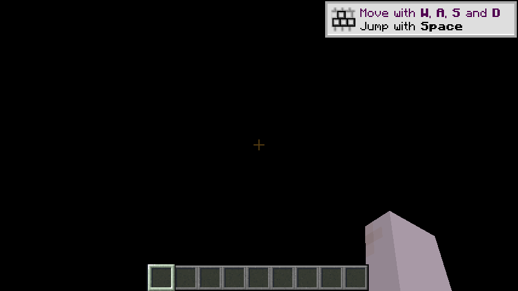

# ballance-mc-passthrough

**中文** | [English](README.en.md)

把 **Minecraft 的画面按 alpha 合成进 Ballance**，并让两个**未经修改**的游戏互相驱动：
Ballance 的镜头和球位送给 MC 当相机，Ballance 的鼠标键盘送给 MC 当输入。

目标玩法：在 Ballance 的球道上**摆方块、放 TNT、拿苦力怕炸那颗球** —— 球能撞上你搭的墙、
能站在你搭的桥上。

技术蓝本是 [rehan-remade/universal-modder](https://github.com/rehan-remade/universal-modder) 里的
`minecraft-gta5-passthrough`（GTA5 ↔ Minecraft）。蓝本的**内容层**（MC 侧的方块/怪/TNT/交互）
整个可以搬过来，要换掉的是"宿主适配层"：GTA 的 native 调用 → Ballance 的 Virtools CK2。

> 本文 2026-11-07 重写，2026-11-10 再对齐一次。11-07 那版修的是两个毛病：里程碑表停在
> "进行中"（M1 / M1c / M2b 早已验收）、全文没有一段**怎么把两个游戏跑起来**（11-07 那次
> "没有任何 MC HUD、视角跑到原点" 就是只开了 Ballance 那一半造成的）。11-10 这版对齐的是
> 11-08 那一整天的四个人工 bug：换关卡崩溃、方块放不上去、准星不跟球、最小化掉到 5 fps。

## 0. 开跑（三分钟）

**两个进程，顺序不能反。** 只有 MC 在跑，Ballance 才有东西可贴；MC 不在，画面里一格 MC 都没有。

### 0.1 两步

```bat
:: 1) 先起 MC —— J:\bmc-project\runtime\mc 里的启动器（自带 JDK），
::    等它自己进虚空世界，20–40 秒
:: 2) 再起 Ballance（双击即可）
J:\bmc-project\runtime\run-ballance-mc.bat
```

`run-ballance-mc.bat` 只做两件事：设 `BALLANCE_MC_PASSTHROUGH=1`，然后起 `Bin\Player.exe`。
同目录的 `run-ballance-plain.bat` 设成 `0`，用来做"开/关穿透"的 A/B 对照。

### 0.2 三条容易踩的

1. **直接双击 `Bin\Player.exe` = 原版 Ballance。** 双击带不上环境变量，
   `BALLANCE_MC_PASSTHROUGH` 没设，穿透就整个关着。这是故意的：邮箱坏了也不能让游戏起不来。
2. **顺序反了会一直等。** 先开 Ballance 再开 MC，日志是
   `waiting for ...ballance_mc_frame.dat (producer not running yet, error 2)`，等一整轮也不会自己好。
3. **MC 窗口可以最小化，但不能关。** 贴进 Ballance 的是 MC 每帧渲染出来的图，关掉就断了源头。
   最小化曾经是致命的（原版把最小化窗口限到 10 fps，实测只有 5），11-08 已放开到 60，
   见 2.3。

### 0.3 怎么确认真的通了

| 看哪 | 应该看到 |
|---|---|
| `runtime\Bin\mc-passthrough.log`（每 2 秒一行） | `mapped … (4923136 bytes)` → `baseline frame N (published before this run, not drawn)` → `frames=… draws=… (N fps consumed)` |
| `runtime\mc\logs\latest.log` | `published N frames in 5s (~N fps), skipped N, failures 0, transparent 87.6%`、`applied pose … at=(x, y) gap=66.0px aim=(yaw, pitch)` |
| Ballance 窗口 | 准星在球上方（`gap` 那个像素距离）、九格快捷栏贴底、右下角一只手臂 —— **这三样都是 MC 自己画的**，不是 Ballance 补的 |

`waiting for … error 2` 反复出现 = 源头没起来，不是穿透坏了。

## 1. 现在能做什么

| 能力 | 状态 | 证据 |
|---|---|---|
| MC 画面贴进 Ballance，透明的天空透出球道 | ✅ M2b | [docs/mc-void-world.md](docs/mc-void-world.md) |
| 准星 / 快捷栏 / 心 / 手臂跟着那一帧过来 | ✅ | MC 自己画，11-07 从邮箱里解出来的就是它 |
| 相机：MC 的世界跟着 Ballance 的视点走 | ✅ M1 | [docs/m1-camera.md](docs/m1-camera.md) |
| 第三人称只画球、第一人称只画手臂 | ✅ | [docs/steve-in-ballance.md](docs/steve-in-ballance.md) |
| 反向输入：E 开创造物品栏、滚轮换格、点物品 | ✅ M1b | [docs/m1b-input.md](docs/m1b-input.md) |
| 摆方块 / 挖方块，射线打空时在准星前 4.5 格生成 | ✅ M1c | [docs/m1c-place.md](docs/m1c-place.md) |
| 右键在球道上放方块真的落得下来 | ✅ 11-08 | 服务端那只眼每 tick 跟球同步，见 2.3 |
| 准星钉在球上方**固定像素**，镜头再远再近间距不变 | ✅ 11-08 | [docs/m1b-input.md](docs/m1b-input.md) 第五节 |
| 每个关卡一个新的世界；旧世界按时间戳留档，不再删掉 | ✅ 11-07 / 11-08 | [docs/level-worlds.md](docs/level-worlds.md) |
| 认得出是哪一关：Ballance 把关卡文件名写进相机通道，MC 按号取模板 | ✅ M1c | [docs/voxel-import.md](docs/voxel-import.md) 第五节 |
| 关卡地形导入：球道/墙/柱子变成**看不见的** barrier，红石、铁轨、火把有地方放 | ✅ 11-08 | [docs/voxel-import.md](docs/voxel-import.md) |
| 13 关预烘成存档模板，进关卡拷一份；每次进关新实例 | ✅ 11-08 | [docs/voxel-import.md](docs/voxel-import.md) |
| 换关卡不再崩（旧的铺块进度按新关卡重建） | ✅ 11-08 | 见 2.3 |
| MC 窗口最小化不再把整条链路拖到 5 fps | ✅ 11-08 | 见 2.3 |
| MC 侧玩家的碰撞箱是**一格方块**（1×1×1，可回退） | ✅ 11-08 | `BALLANCE_MC_PLAYER_BOX=0` 恢复 0.6×1.8 |
| F1 设置面板，9 行开关就地生效 | ✅ | [docs/settings-panel.md](docs/settings-panel.md) |
| 自由视角：按 F 绕球转镜头，球的行进方向一点不变 | ✅ 11-08 | [docs/free-view.md](docs/free-view.md) |

尺度：**1 方块 = 5.48 Ballance 单位**（默认值，F1 面板**第 8 行** Block 可改）。4.0 是标定表里
"一个球径"的数，但和变球器 `P_Trafo_*` 的 5.48 对不上，取后者，理由见
[docs/scale-calibration.md](docs/scale-calibration.md)；13 关 472,534 个三角全部可离线导出，
烘成 115,461 个方块格（其中可走面 54,279）。

## 2. 真机实测

### 2.1 2026-11-07 冷启动

在 Windows 试玩机（Win11 + 真显卡）上跑，12:31:14 开始：

| 时刻 | 事件 |
|---|---|
| 12:31:19 | 起 MC |
| 12:31:34 | 邮箱 `.dat` 出现（**15 秒**，比估计的 20–40 秒快） |
| 12:31:59 | 起 Ballance |
| 12:33:04 | 抓完最后一帧诊断 |

| 指标 | 值 |
|---|---|
| MC 发布 | **15 fps**，每 5 秒 75 帧，skipped 75，failures 0 |
| 透明占比 | **87.6%**（alpha=0）—— 天空确实被去掉了 |
| Ballance 消费 | 14–24 fps，`frames=1240 draws=3832 misses=1 rejected=0` |
| 陈旧帧防护 | `baseline frame 628 (published before this run, not drawn)` |



上面这张**不是截图**，是直接从帧邮箱里把 MC 发布的那一槽解出来、按 alpha 合成到黑底上的。
这么做是因为当天的桌面截图取证失败了，见 2.2。

### 2.2 踩到并修掉的：陈旧帧

邮箱在 Windows 上就是磁盘上的一个 `.dat`，**进程退出它不会消失**。所以新一轮启动时
消费者第一次映射就能读到上一轮留下的帧，然后一直把它糊在画面上 —— 11-07 的原始报告
"视角跑到坐标原点"有一半就是这个：屏幕上是一张旧的 MC 画面。

修法是首次映射时把当前的 `FrameId` 当作基线（`baseline frame N`），
只画这之后发布的帧。改动在 `tools/ballanced-patches/RenderEngine.patch`。

**锁屏就截不到桌面**：自动化取证用的是 `Graphics.CopyFromScreen`，工作站一锁屏，session 1
的进程就再也拿不到画面（要么一整屏纯黑，要么 `Win32Exception: 句柄无效`）。所以 2.1 的结论
全部走**邮箱解码**这条独立路径：

```python
# header 4096 字节，3 个槽，布局见 tools/passthrough/mpframe.h
magic, ver, w, h, stride = struct.unpack_from("<5I", data, 0)
frameid, slot = struct.unpack_from("<2I", data, 32)
offset = struct.unpack_from("<3Q", data, 56)[slot]
```

### 2.3 2026-11-08：四个人工 bug

一局玩下来报的四件事，根因都不在前一版以为的地方。

**① 15:02:45 崩溃 —— `Index 7206 out of bounds for length 7206`**

`LevelVoxels.placeSome` 在 `adopt()` 换关卡之后，拿**新关卡**的格数（7640）去取模，
索引进**旧关卡**的 `done[]`（7206）。修法：`adopt()` 换关卡时清 `done/cursor/计数`，
`placeSome` 开头再校验一次长度，不一致就重建；顺带让"全部铺完即 return"，
不再每 tick 扫 7000 格。

**② 方块"闪一下然后没了"，某处一直放不上**

服务端那只玩家的眼落后客户端 **8.0 格**，一停就是几十秒。客户端每 tick 把自己 snapTo 到球上，
服务端的玩家只有移动包能带动，而服务端一旦在等某个瞬移被确认，之后的移动包会被静默丢掉。
于是瞄到方块时走原版放置 → 服务端从头算距离 → 超出手长 → 拒绝 → 客户端收回，方块闪一帧。

修法：`CameraSync` 每 tick 把同一个位置/朝向写进 `IntegratedServer` 的 `ServerPlayer`，
**不经过网络** —— 本地单机服务端就在同一个进程里，手长与视线从此按准星那份位置算。
配套两处：位姿在 tick **开头**应用（原来是 TAIL，本 tick 的射线和下一帧的摄像机用的是两份
位姿，这是选中框闪烁的来源）；右键派发前用刚算出的 pick 刷新 `client.hitResult`。

**11-13 复盘：第②条只对了一半。** 一局 2 分 12 秒的日志（`bmc-tpl-10`）里，14 次右键的
`clientSays` / `serverSays` **14/14 全同**，两侧眼睛差 0.00–0.11 格 —— 同步早就修好了，
「某处放不上」另有原因：那 3 次的目标格本来就是关卡自己的不可见 `barrier`，原版没有格子可放。
现在右键分四种情况（打空 / 目标格空着 / 目标格是 barrier / 其余），barrier 那种改成换掉那一格，
其余拒绝会写 `blocked_by=`；每次放置四个 tick 内回读一次，日志给 `placement ok` 或
`placement refused` —— 按下去成没成，不再从位置读数里推。`aim target changed` 的判据也换了：
原来是「1 秒内变 8 次」，而那是高速滚球和重生传送的常态（那局 6 次报告全是 24 格瞬移），
现在数的是「回到刚离开的那一格」（A→B→A）。见 [docs/m1c-place.md](docs/m1c-place.md) 第一节。

**③ 准星不跟球**

"不跟"其实是**间距在变**：抬角转的是 20°，而 20° 折成多少像素取决于相机离球多远
（实测 6.66..18.71 格），球一快镜头跟不上，球自己甩出画面中线最多 26°，差额全加在间距上 ——
同一局 73 个位姿样本里，准星到球的距离 **39.2 .. 108.1 px**。

改法不是"转一个角度"，是换计量方式：准星画在**球自己的投影 + 固定像素**
（`CameraSync.gapGui`，`AimLift` 仍是唯一控件、仍 0..30 度，刻度 3.3 px/度，20° = 66 px），
再**解析反求**玩家旋转使落点落在那颗像素上 —— 落点既要在相机过该像素的射线上，又要离眼睛
正好 4.5 格，即"射线 ∩ 球面"，取**远根**（近根会把方块夹在球和相机之间）。
73 个样本离线复算：间距全部 **66.00 px**，上下 0.0。

**④ 最小化掉到 5 fps**

MC 日志每 5 秒一行：窗口在后面时 `~25 fps`，一最小化立刻 `~5 fps`
（`Cannot acquire minimized window`），Ballance 侧同步掉到 `4-5 fps consumed`。
命中 `FramerateLimitTracker` 的 `WINDOW_ICONIFIED`（原版 10，实测 5）。
`FramerateLimitTrackerMixin` 只放开这一条分支：默认 60，`BALLANCE_MC_ICONIFIED_FPS` 可调，
AFK 限速和玩家自己的帧率设置原样不动。

**⑤ 附带的：烘焙世界解不开**

存档路径带一个 `.` 分量（`…\runtime\.\mc\saves`），`Path.normalize()` 把它从条目目标里
去掉了、却留在 `dir` 里，于是 30 个条目全部被判成"逃出目录"，一个文件都没解开，没有
`level.dat`，客户端静默退回纯虚空世界。修法：包含性检查两边都先
`toAbsolutePath().normalize()`。

## 3. 还没做到

| 阶段 | 内容 | 缺什么 |
|---|---|---|
| M2c | 深度合成（重投影） | 柱子还挡不住 MC 的墙 —— 现在是整帧 alpha 混合，没有逐像素深度 |
| M3b | 地面 raycast | Steve 还不会站在球道上，脚下穿模 |
| M3c | 方块 → 碰撞体 | **球还撞不上你搭的墙** —— 这条是目标玩法的主干（PoC-2 已证明机制可行） |

已知边界（不是 bug，是当前口径）：

- 准星间距恒定的代价：镜头特别远的帧（关卡刚进、18.7 格）玩家的俯仰会比原来抬一点，
  方块因此落在球上方一格多而不是球心附近 —— `AimLift` 调小就回到球上。
- 打开创造物品栏时球会冻结（`timeScale` 归零），这是设计，不是卡住。
- 烘焙模板把格子大小写死了（默认 5.48 u）：面板第 8 行调成别的值，mod 会拒绝铺并打一行警告，
  换尺寸要重跑 `voxelize.py` + `bake-levels.sh`。

## 4. 两个通道

| | 帧通道（M0b） | 相机通道（M1） |
|---|---|---|
| 方向 | MC → Ballance | Ballance → MC |
| 内容 | BGRA8 像素，3 槽轮转，与 Ballance 窗口同宽高 | 约 100 字节标量 + 输入字段 |
| 写者 | Fabric mod | `Source/Player/src/MinecraftCameraSync.cpp` |
| 读者 | `CKSdlGpuPassthroughTick` | `McCameraChannel` → `CameraMixin` |
| Linux | `/dev/shm/ballance_mc_frame` | `/dev/shm/ballance_mc_camera` |
| Windows | `%LOCALAPPDATA%\BallanceMcPassthrough\ballance_mc_frame.dat` | 同目录 `ballance_mc_camera.dat` |
| 顺序 | `FrameId` 发布，acquire/release | **seqlock**（Seq 前后各读一次） |

邮箱布局是 `tools/passthrough/mpframe.h`，两端各有一份镜像实现，
`tools/passthrough/inspect-mailbox.py` / `inspect-camera.py` 是独立第三方读者 ——
**它们能读通，才说明布局没走样**。

| 环境变量 | 谁读 | 作用 |
|---|---|---|
| `BALLANCE_MC_PASSTHROUGH=1` | Ballance | 总开关，默认关 |
| `BALLANCE_MC_SHM` | 两端 | 邮箱名，默认 `ballance_mc_frame` |
| `BALLANCE_MC_MAILBOX` | Ballance | 直接给绝对路径 |
| `BALLANCE_MC_FPS` | MC | 发布限速，默认 30 |
| `BALLANCE_MC_ICONIFIED_FPS` | MC | 窗口最小化时的目标帧率，默认 60 |
| `BALLANCE_MC_PLAYER_BOX=0` | MC | 碰撞箱回到原版 0.6×1.8 |
| `BALLANCE_MC_EXPORT=0` | MC | 完全关闭导出（也就关掉了上面两条） |

面板那 9 行的 ini 键与环境变量见 [docs/settings-panel.md](docs/settings-panel.md)。

## 5. 里程碑

| 阶段 | 内容 | 状态 |
|---|---|---|
| PoC-0 | 可行性：深度 / raycast / 动态碰撞体 / Linux 构建 | ✅ [docs/feasibility.md](docs/feasibility.md) |
| PoC-1 | 在深度上挂探针，落盘一帧 | ✅ [docs/poc1-depth.md](docs/poc1-depth.md) |
| PoC-2 | 动态 obstacle 加/删，球能撞上 | ✅ [docs/poc2-obstacles.md](docs/poc2-obstacles.md) |
| M0 | 共享内存链路 + 全屏贴图 | ✅ |
| M1 | 相机 + 球位 = Steve 位 | ✅ 11-05 |
| M1b | 反向输入：E / 鼠标 / 滚轮驱动 MC 物品栏 | ✅ [docs/m1b-input.md](docs/m1b-input.md) |
| M1c | 在世界里放 / 挖方块、认关卡、地形导入 | ✅ 11-07 / 11-08 |
| M2a | 虚空世界 + 去天空 | ✅ [docs/mc-void-world.md](docs/mc-void-world.md) |
| M2b | Ballance 侧 alpha 混合 | ✅ 11-06 |
| M2c | 深度合成（重投影） | ⬜ |
| M3a | 输入转发（世界里的左右中键 / 右键放置） | ✅ 11-08（服务端眼同步后才真正可靠） |
| M3b | 地面 raycast | ⬜ |
| M3c | 方块变碰撞体 | ⬜ |

## 6. 目录

```
docs/feasibility.md        PoC-0 的证据与结论
docs/poc1-depth.md         PoC-1 深度探针
docs/poc2-obstacles.md     PoC-2 动态碰撞体
docs/m1-camera.md          M1 相机通道，含三个坑
docs/m1b-input.md          M1b 反向输入 + 准星间距（2026-11-08）
docs/m1c-place.md          M1c 放/挖方块，含 FOV 与画幅口径
docs/mc-void-world.md      M2a/M2b 虚空世界 + alpha 合成，五个坑
docs/steve-in-ballance.md  Steve 的身体怎么画
docs/free-view.md          自由视角（F 键绕球）
docs/free-camera.md        自由相机（调试用）
docs/level-worlds.md       每关一个新世界、旧世界留档
docs/voxel-import.md       关卡地形 → barrier、13 关烘焙模板（2026-11-08）
docs/settings-panel.md     F1 面板的九行与优先级
docs/level-parse.md        离线读关卡几何
docs/scale-calibration.md  尺度标定表
docs/windows-build.md      Windows 真机包怎么编（工具链 / 坑 / 铺目录）
docs/bmlplus-hooks.md      BML+ 钩子能力核查（另一条路）
docs/bmlplus-hud-mod.md    ".bmodp 版 HUD" 的可行性（当前未采用）
docs/*-shots/              验收截图
mc-mod/                    MC 侧 Fabric mod（含 assets/ballance/templates 的 13 关模板）
tools/passthrough/         帧/相机通道的协议、两半实现、验收脚本
tools/voxel/               三角 → 方块格 → 烘焙 → 打包模板
tools/ballanced-patches/   对上游 Ballanced 四个子模块的补丁（见 §7.4）
tools/windows/             真机上的三个批处理（启动器 / 铺目录 / 重编+部署）
tools/windows-sync.sh      打包源码 → 上传 → 解包（可加 --build / --jar / --deploy）
tools/nmo_geom.cpp         读 .nmo 导出世界空间 OBJ + JSON（libcmo21）
tools/calibrate.py         由导出产物生成尺度表
external/fetch-upstream.sh  拉上游 Ballanced / CKRenderEngine（不随本仓库分发）
```

## 7. 产物与部署

### 7.1 两件产物

| 产物 | 从哪来 | 落到哪 |
|---|---|---|
| MC 侧 mod jar | `cd mc-mod && ./gradlew25 build` → `mc-mod/build/libs/ballance_passthrough-1.0.0.jar` | `runtime\mc\mods\` |
| Ballance 侧 `Player.exe` + 插件 DLL | `tools/windows/rebuild-pt.cmd`（计划任务 `bmc-pt`）：configure → build → robocopy | `J:\bmc-project\runtime\{Bin,RenderEngines,…}` |

当前构建（`2ef805b`）的 jar 是 **12,581,522 字节，md5 `2ffd92b70e2f6faa03550c7cc34784f8`**。
2026-11-13 这份只在开发机构建并跑过 Linux 冒烟，**还没有铺到 128 上**（当时那台不可达），
盘上仍是 11-08 的 `66bfb760…`。

`rebuild-pt.cmd` 只把 `.exe`/`.dll` 拷进运行目录，**不碰** `Player.ini` / `Minecraft.ini` /
日志，所以重编不会丢你面板里的设置。注意按仓库作者自己的说明：**渲染器是插件不是主程序**，
换代码后 `Player.exe` 的 mtime 可能不变，真正变的是 `RenderEngines\CKSdlGpuRasterizer.dll` ——
别把"exe 没变"当成没编。

### 7.2 源码怎么过去

**Windows 那边不存源码，只存拷贝。** 一律 `tools/windows-sync.sh` 从开发机打包推过去，
换机器、重装、复现都走同一条路（细节与三个坑见 [docs/windows-build.md](docs/windows-build.md)）。

### 7.3 `artifacts\SHA256SUMS.txt` 覆盖什么

运行目录旁边的 `artifacts\` 是发布快照，`SHA256SUMS.txt` 现在有 **5 行**：

```
runtime/mc/mods/ballance_passthrough-1.0.0.jar
artifacts/ballance_passthrough-1.0.0.jar
artifacts/Player.patch
runtime/Bin/Player.exe
runtime/RenderEngines/CKSdlGpuRasterizer.dll
```

**它不含** `CK2.dll` / `VxMath.dll` / `CK2_3D.dll` / `SDL3.dll`，也不含本 README ——
都是上游构建产物或文档，改了不必重算这几个数。核对办法只有一条：`certutil -hashfile <文件> SHA256`
逐行比对，别拿 md5 去对 SHA256 的档。

### 7.4 补丁归档的现状

Ballanced 的四个子模块（`Player` / `BuildingBlocks` / `RenderEngine` / `SdlInputManager`）
在上游都是独立仓库，我们改的东西**提交不进 Ballanced 本身** —— `git submodule update`
会把它们悄悄冲掉。所以补丁是唯一的长期记录，`tools/ballanced-patches/apply.sh` 负责贴回去。

**这里有一个已知的欠账**：`tools/ballanced-patches/Player.patch` 是 2026-11-08 14:45 导出的，
而 `Source/Player` 在 17:02 和 17:39 又提交了两次（`9ebf664` / `99be8e9`，认球的局部包围盒）。
**当前真正的增量是 `git -C Source/Player diff e5073295..HEAD`（5,724 行 / 252,358 字节）**，
不是仓库里那份。要用补丁重建，请以这条命令为准；归档什么时候刷新见提交历史。

## 8. 上游与许可

```sh
./external/fetch-upstream.sh          # 默认拉到 ../Ballanced 与 ../CKRenderEngine
```

- [doyaGu/Ballanced](https://github.com/doyaGu/Ballanced)（branch `sdl`，MIT）—— 源码级复刻的 Ballance 运行时，SDL3
- [doyaGu/CKRenderEngine](https://github.com/doyaGu/CKRenderEngine)（branch `sdl`，Apache-2.0）—— Virtools CK2 渲染引擎，带 SDL3 GPU 光栅器

上游是 Ballance 的反编译/复刻代码，**需要正版 Ballance 资产**，本仓库不含任何游戏资源。
本仓库只放自己的代码与文档，上游一律按脚本拉取（不 vendored、不改别人的 LICENSE）。
本仓库代码本身按木兰宽松许可证第 2 版授权，见 [LICENSE](LICENSE)。
