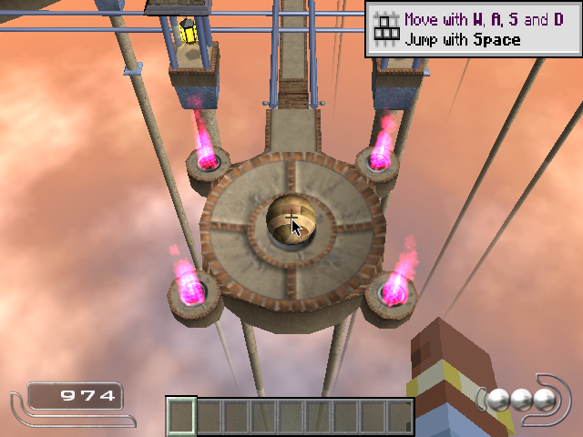
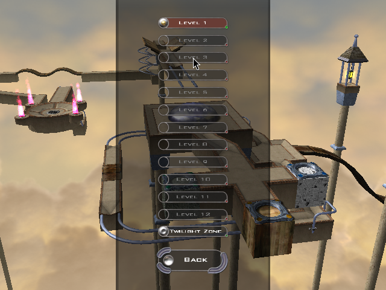

# M2a：MC 侧的虚空世界 + 去天空

目标只有一句话：**让 Minecraft 那一帧变成一张只有方块和实体的透明图层**，
背景全空，好让 Ballance 从下面透上来。

这一版全在 MC 侧（Fabric mod），Ballance 侧一行没改。

## 一、做了什么

| 件 | 在哪 | 作用 |
|---|---|---|
| 虚空世界自动开 | `McWorldBootstrap.java` | 启动后自动新建/打开存档 `passthrough` |
| 去天空 | `mixin/LevelRendererMixin.java` | 掐掉 `addSkyPass`（天穹/太阳/月亮/星星） |
| 去云 | `mixin/CloudRendererMixin.java` | 云不在天空 pass 里，单独两条渲染路径 |
| 去雨雪 | `mixin/WeatherEffectRendererMixin.java` | 同上，也是独立 pass |
| 布景 | `McWorldBootstrap.dressScene` | 时间冻住、不下雨、不刷怪、创造 + 飞行、放到 (0,100,0) |
| 透明读回 | `McFrameExport.capture` | 自己读回，**保留 alpha**（见坑 5） |
| 透明度统计 | `McFrameExport` | 每 5 秒的统计行多了 `transparent NN.N%` |

开关（环境变量）：

| 变量 | 默认 | 作用 |
|---|---|---|
| `BALLANCE_MC_VOID` | 开 | `0` = 不自动开世界，停在标题界面 |
| `BALLANCE_MC_VOID_WORLD` | `passthrough` | 虚空世界的存档名 |
| `BALLANCE_MC_SCENE` | `auto` | `auto` 只在自己开的虚空世界里去天空；`1` 强制任何世界都去；`0` 全关 |
| `BALLANCE_MC_WORLD` | 无 | 老行为：直接打开这个已有存档（**不布景、不去天空**） |

## 二、为什么「背景透明」不用改雾色

26.3 的 `LevelRenderer.render` 清屏是这样的（反编译原文）：

```java
clearPass.executes(() -> RenderSystem.getDevice().createCommandEncoder()
    .clearColorAndDepthTextures(mainRenderTarget.getColorTexture(),
        new Vector4f(fogColor.x, fogColor.y, fogColor.z, 0.0F),
        mainRenderTarget.getDepthTexture(), 0.0));
```

**alpha 写死 0**。也就是说从 26.3 起，MC 的主渲染目标本来就是「透明背景 + 雾色 RGB」，
不需要我们去改雾色或清屏色——挡住透明的只有天空/云/天气那几个不透明 pass。
老版本（清屏用不透明黑）才需要动雾色，这条结论只对 26.3 成立。

## 三、五个坑

### 1. `LevelStorageSource.levelExists` 只判断目录在不在

2026-11-05 那次「无头 MC 进不了世界」的真相是：`BALANCE_MC_WORLD=m1test` 指向的存档
目录只剩一个 `session.lock`（`level.dat` 没了），`openWorld` 静默落到
`RecoverWorldDataScreen`，日志里一个字都没有。**判据要改成 `level.dat` 在不在**，
本仓库现在就是这么判的（`McWorldBootstrap.hasLevelData`）。

顺带更正 docs/m1-camera.md 的坑 3：无头 MC **能**进世界，之前那条结论是上面这个坏存档
造成的误判。实测（2026-11-06，Xvfb :99）整条链都跑通了：世界加载 → `Server thread`
起来 → `CameraSync` 每 tick 把玩家搬到球位。

### 2. `createFreshLevel` 给的 provider 里没有 `LEVEL_STEM`

`WorldOpenFlows.createFreshLevel` 把这个 provider 传给你的维度工厂：

```java
WorldDimensions dimensions = dimensionsProvider.apply(context.datapackWorldRegistries());
Complete complete = dimensions.bake(context.datapackDimensions().lookupOrThrow(Registries.LEVEL_STEM));
```

它**只有世界生成类注册表**（BIOME / DIMENSION_TYPE / FLAT_LEVEL_GENERATOR_PRESET …），
`minecraft:dimension`（LEVEL_STEM）是后面 `bake` 时才补的。所以不能在里面
`lookupOrThrow(Registries.LEVEL_STEM)` 去拼维度集合——第一次跑就是这么炸的：
`IllegalStateException: Registry minecraft:dimension not found`。
正确写法：

```java
WorldPresets.createNormalWorldDimensions(registries).replaceOverworldGenerator(registries, generator)
```

### 3. 虚空 ≠ 零层

超平坦预设 `the_void` 不是「一层都没有」，而是 **一层空气 + `the_void` 生物群系、
无结构无湖**（`FlatLevelGeneratorPresets.bootstrap` 原文）。照抄它才和菜单里
「超平坦 → the_void」完全一致。生成器是 `new FlatLevelSource(settings)`。

### 4. 虚空世界里玩家会掉下去摔死

第一次试跑（打开一个普通存档）就撞上了：客户端进了世界，然后卡在 **You Died** 界面。
所以布景里必须给飞行：服务端 `ServerPlayer.getAbilities().flying = true` +
`onUpdateAbilities()`，客户端才跟着改。只改客户端会被服务端的 abilities 包覆盖。
出生点在 y=-64 附近（`FlatLevelSource.getSpawnHeight` 取世界底部），所以布景里顺手
`teleportTo(0.5, 100.0, 0.5)`，和 M1 的 `BALLANCE_MC_ANCHOR` 默认值对齐。

### 5. `Screenshot.takeScreenshot` 会把 alpha 抹成 255

这是这一版最关键的一坑。M0b 以来帧通道一直借 MC 自己的截图路径读回：

```java
image.setPixelABGR(x, height - y - 1, argb | 0xFF000000);   // ← 这里
```

那是给人看的截图，alpha 被写死成全不透明。于是**渲染管线里 alpha 明明是 0，
送到信箱里全变成 255**——第一轮实测就是 `transparent 0.0%`，而画面内容其实已经
只剩透明背景 + HUD。

`McFrameExport.capture` 现在自己走一遍同样的读回
（`createBuffer` → `copyTextureToBuffer` → `map`），只去掉那个或运算，
顺手在同一趟循环里做上下翻转、R/B 交换和 alpha 统计。

## 四、验收（2026-11-06，Xvfb :99，854x480）

`tools/passthrough/void-frame.py` 读帧通道数 alpha：

| 桶 | 像素 | 占比 |
|---|---|---|
| `a=0` | 355 168 | **86.64%** |
| `0<a<64` | 0 | 0.00% |
| `64<=a<255` | 9 080 | 2.22% |
| `a=255` | 45 672 | 11.14% |

剩下那 13% 是**画面里本来就有的东西**：快捷栏、准星、右上角的教学提示、
右下角的第一人称手臂（粉红色那团）。也就是说：**除了 HUD 和手，画面全透明**，
没有天、没有云、没有地面。

日志里每 5 秒的 `transparent 87.6%` 是同一个数的连续版本，可以用来盯长时间稳定性。

两帧留档（`docs/void-shots/`）：


棋盘格那张是把 alpha 当遮罩铺在棋盘上：**棋盘露出来的地方就是透明的**。
右下角那团粉色是第一人称手臂，底下是快捷栏，中间是准星。

## 五、合成：alpha 混合（2026-11-06 补上）

上面说的「贴一张不透明的图」已经修掉。位置在 present stage，不在 passthrough 自己身上：

* `CKFFPresentDraw::Prepare` 多一个 `AlphaBlend` 参数，`SubmitCopy`（贴 MC 帧）传 `TRUE`，
  `Submit` / `SubmitBlit`（resolve、blit）传 `FALSE`。
* 混合因子：颜色 `VXBLEND_SRCALPHA / VXBLEND_INVSRCALPHA`，alpha 通道单独给
  `VXBLEND_ONE / VXBLEND_INVSRCALPHA`——帧里的 alpha 是直通值，不做预乘。
* 纹理本来就按 `CKRST_TEXTURE_RGB | CKRST_TEXTURE_ALPHA` 建、`_32_ARGB8888` 上传，
  所以 alpha 一路没丢，缺的只是 pipeline 状态里那个混合位（`CKDrawStateBuilder` 默认不混合）。

于是 alpha=0 的地方让位给 Ballance 的场景。**没有深度**：Ballance 的柱子挡不住 MC 的墙，
那要等 M2 的重投影。

同时删掉 Ballance 侧手搓的 HUD（`MinecraftHud.*`，约 780 行，外加面板里的 Hud / HudScale 两行）：
帧里自带的准星/快捷栏/心/手臂一直是真的，两套叠着只是重影。

## 六、合成实测（2026-11-06，Level 08）



跑法（两万多次调用里唯一能复现的一条）：

1. 先起 MC 客户端（虚空存档 `passthrough` 自动开），再起 Ballance：
   `BALLANCE_MC_PASSTHROUGH=1 BALLANCE_MC_CAMERA=1 BALLANCE_MC_STEVE=0 BALLANCE_MC_STEVE_FP=0`。
   关掉 Steve 的相机是为了拿到游戏自己的 `InGameCam`（第三人称跟球），画面里才有赛道。
2. 主菜单点 `CREDITS` → 键盘输入 `gravity`（原作彩蛋）→ 解锁全部关卡 → `BACK` → `START`。
   新开档只有第 1 关可选，其余关卡点了没反应；这条彩蛋是唯一不用通关就能进第 8 关的路。
3. 点 `LEVEL 8`，等 12 秒让球落地。

两个坑：

* **xdotool 的 `click` 不够**：指针要分十来步移动过去再按，否则游戏里的悬停/点击还停在旧位置——
  表现就是「点 CREDITS 没反应，OPTIONS 却亮着」。脚本见 `tools/passthrough/enter-level-8.sh`。
* 关卡列表里 `DB_Levelfreischaltung`（12 行 `Freigeschaltet?`）是解锁状态，但直接把它全置 1
  **不生效**：按钮的激活状态在菜单初始化时就定了（`Menu_Start_ShowHide` 的 `Activate?`），
  改数组只对下一次菜单初始化有效。彩蛋走的就是游戏自己的初始化路径。

这次抓到的帧（`tools/passthrough/inspect-mailbox.py`）：854x480，`a=0` **87.48%**，
`64<=a<255` 2.25%，`a=255` 10.27%（快捷栏 + 手臂 + 右上角提示）。Ballance 侧 4 fps 消费
（MC 客户端这时只有 ~5 fps，llvmpipe 软渲染）。

菜单上的合成更直观——MC 的方块（箱子、石台、火把）盖在 Ballance 的选关界面上：


